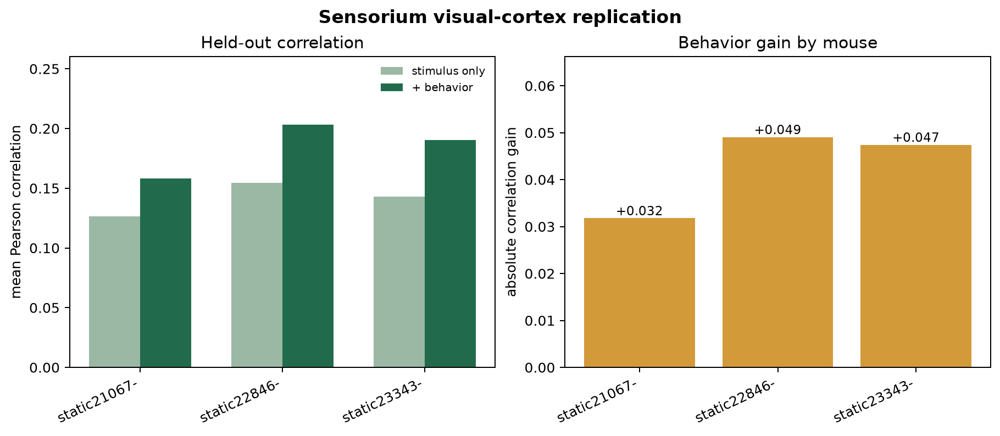

# Does a mouse's behavior help predict its visual cortex?

A neuroscience + machine-learning project using public mouse V1 recordings
(Sensorium 2022). We build **encoding models** that predict neural activity from the
image a mouse sees, then test whether adding **behavior** (pupil size, running speed)
improves held-out prediction.

## Result

Adding behavior improved held-out prediction in **all three mice tested**:

| Mouse | Neurons | Image only | + behavior | Relative gain |
|---|---:|---:|---:|---:|
| `static21067` (discovery) | 8,372 | 0.126 | 0.158 | +25% |
| `static22846` (replication) | 7,344 | 0.154 | 0.203 | +32% |
| `static23343` (replication) | 7,334 | 0.143 | 0.191 | +33% |

*Mean per-neuron test correlation, ridge regression on image PCA features.*



- **Pupil (arousal) helped every mouse.** Running helped by very different amounts
  across animals (almost nothing in the first mouse, which ran on ~5% of trials).
- **Controls:** shuffling behavior across trials removes the gain (about −0.0005), and
  the mean gain stays positive when any one mouse is left out.
- **Deep-network check:** pretrained CNN features barely beat raw pixels, and behavior
  helps either way.

**What this does and doesn't show:** it supports the claim that behavioral state carries
predictive information about V1 activity. Three animals are a replication, not a
population estimate, and the analysis is predictive, not causal. A trial-offset timing
experiment was uninformative because Sensorium's trial order is shuffled (see
[`docs/REPLICATION_PLAN.md`](docs/REPLICATION_PLAN.md)).

## Read more

- 📄 **Full write-up:** [`docs/REPORT.md`](docs/REPORT.md)
- 🖼️ **Poster (one page):** [`poster/poster.pdf`](poster/poster.pdf)
- Pre-specified protocol: [`docs/REPLICATION_PLAN.md`](docs/REPLICATION_PLAN.md)
- Clean-environment run record: [`docs/REPRODUCIBILITY_RUN.md`](docs/REPRODUCIBILITY_RUN.md)
- Original project plan: [`docs/PROJECT_PLAN.md`](docs/PROJECT_PLAN.md)
- Per-mouse numbers: [`results/per_mouse_metrics.csv`](results/per_mouse_metrics.csv)

## Notebooks (open in Colab)

| Step | Notebook |
|---|---|
| 1. Python and data | [Open](https://colab.research.google.com/github/AmishI123/neuroscience-project/blob/main/notebooks/01_python_and_data.ipynb) |
| 2. Real data exploration | [Open](https://colab.research.google.com/github/AmishI123/neuroscience-project/blob/main/notebooks/02_real_data_exploration.ipynb) |
| 3. Baseline model (image only) | [Open](https://colab.research.google.com/github/AmishI123/neuroscience-project/blob/main/notebooks/03_baseline_model.ipynb) |
| 4. Add behavior (core result) | [Open](https://colab.research.google.com/github/AmishI123/neuroscience-project/blob/main/notebooks/04_add_behavior.ipynb) |
| 5. Analysis and figures | [Open](https://colab.research.google.com/github/AmishI123/neuroscience-project/blob/main/notebooks/05_analysis.ipynb) |
| 6. Deep-learning stretch (GPU) | [Open](https://colab.research.google.com/github/AmishI123/neuroscience-project/blob/main/notebooks/06_deep_learning_stretch.ipynb) |

Use **File → Save a copy in Drive** the first time so your work is saved.

## Reproduce the replication

```bash
pip install -r requirements.txt
# download a mouse (~424 MB) from https://gin.g-node.org/cajal/Sensorium2022, unzip it, then:
python src/replicate_mouse.py /path/to/static21067-10-18-... --output result.json
```

Other scripts in `src/`: `summarize_replication.py`, `plot_replication.py`,
`shuffle_behavior_control.py`, `analyze_behavior_timing.py`. See
[`docs/REPRODUCIBILITY_RUN.md`](docs/REPRODUCIBILITY_RUN.md) for the verified run.

## Repository layout

| Folder | Contents |
|---|---|
| `notebooks/` | Step-by-step Colab notebooks |
| `src/` | Replication, summary, plotting and control scripts |
| `results/` | Figures, per-mouse metrics, control outputs |
| `docs/` | Report, protocol, reproducibility record, plan |
| `data/` | Datasets (downloaded locally, not committed) |
| `application/` | Application essay drafts |

## Related projects

- **Portfolio and story:** [ASDRP Neuroscience Portfolio](https://amishi123.github.io/neuroscience-portfolio/) ties these projects together.
- **Next Step:** [AmishI123/next-step](https://github.com/AmishI123/next-step), a calm web app that asks how much energy you have and shows only the next step on a low day. Built with AI tools, with advice and guidance from a parent.
- **Neurocomms:** [AmishI123/neurocomms-app](https://github.com/AmishI123/neurocomms-app), communication-support prototypes and Helper Jobs. Same build notes; fictional data only.

## Method in one line

Ridge regression (scikit-learn) on 150 image principal components, comparing a
stimulus-only model against stimulus + behavior on held-out trials.
