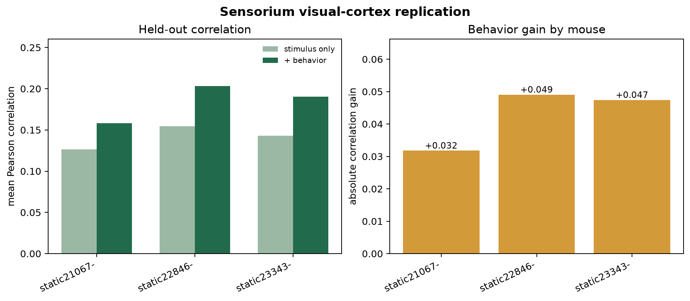
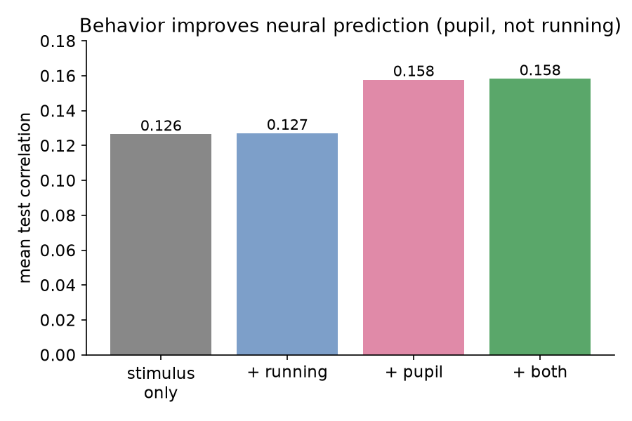
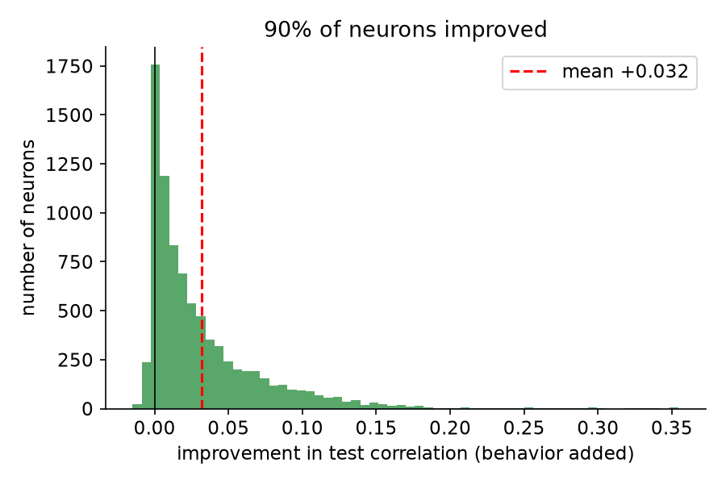
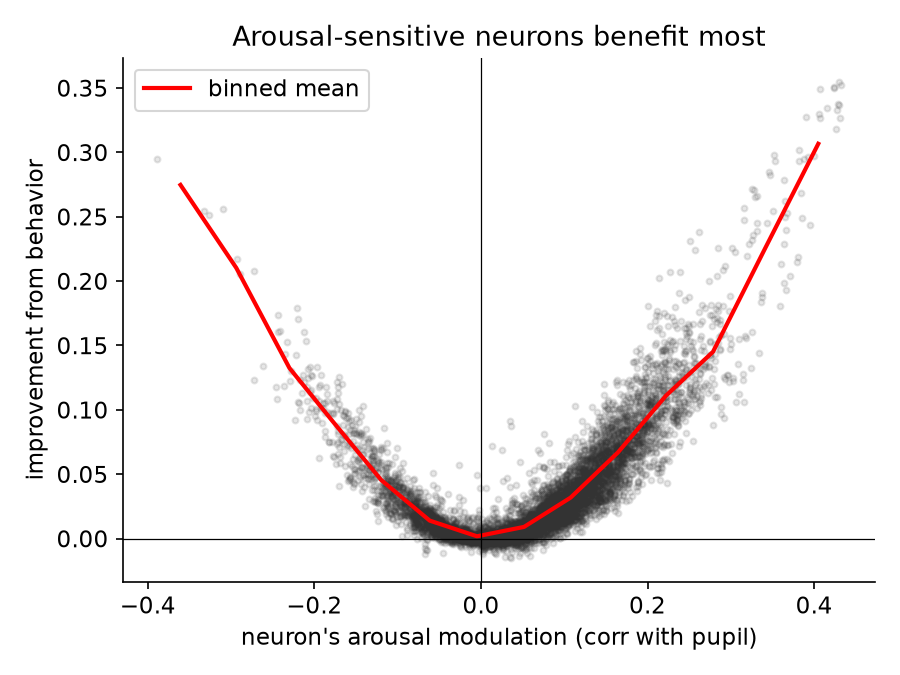
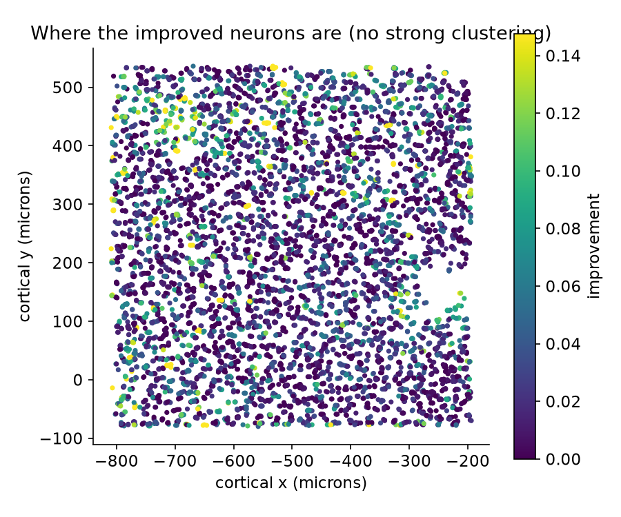
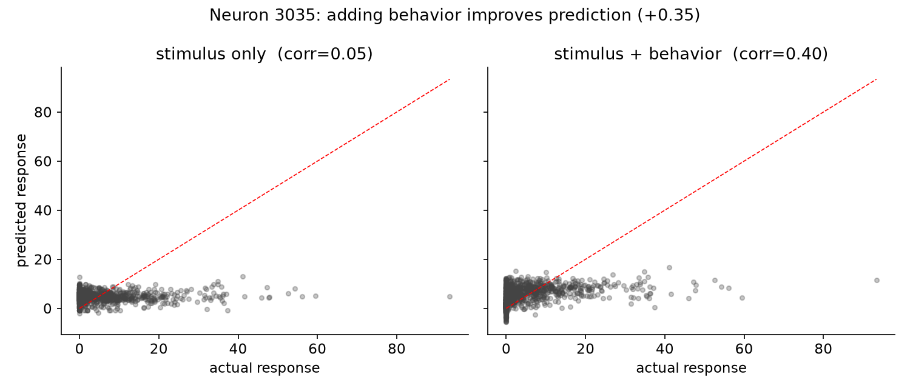
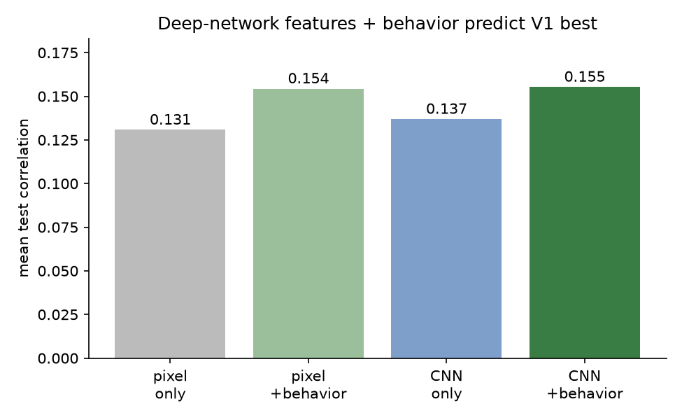

# Does Behavioral State Improve Prediction of Mouse Visual Cortex Activity?

*An encoding-model study of arousal and locomotion in mouse primary visual cortex (V1), replicated in three mice.*

**Author:** Amishi Mehta · with advice and guidance from Manish Mehta (parent)
**Code & data:** https://github.com/AmishI123/neuroscience-project
**Portfolio (results, slides, video and apps):** https://amishi123.github.io/neuroscience-portfolio/

---

## Abstract

Encoding models predict how visual-cortex neurons respond to images, but real neurons
respond to the same image differently depending on the animal's internal state. Using
public Sensorium 2022 recordings (7,300–8,400 V1 neurons per mouse), we asked whether
adding pupil size and running speed to a linear encoding model improves held-out
prediction beyond the image alone. In a discovery mouse, mean prediction accuracy rose
from **0.126 to 0.158** (Pearson correlation). Two further mice, analysed with the same
pipeline chosen in advance, rose from **0.154 to 0.203** and from **0.143 to 0.191**:
a gain of 25–33% in every animal. Pupil improved prediction in all three mice, while
running helped only in the two that ran more. The gain disappeared when behavior was
shuffled across trials, survived dropping any one mouse, and held when the image model
was replaced with pretrained deep-network features. Within the discovery mouse, the
neurons that gained most were those whose activity tracked arousal. These results
support a predictive claim, that behavioral state carries information about V1 activity
that the image does not, and leave population-level estimates and causal mechanism
open.

## Key findings

1. **Behavior improved prediction in 3 of 3 mice** (+0.032, +0.049, +0.047 correlation
   points; +25%, +32%, +33%).
2. **Pupil helped every mouse; running depended on the mouse.** It added almost nothing
   in the mouse that rarely ran.
3. **The gain needs correctly aligned behavior.** Shuffling behavior across trials
   reduced it to about −0.0005 in every mouse.
4. **Arousal-sensitive neurons gained most** (+0.069 vs +0.014 for the rest, discovery
   mouse).
5. **The result does not depend on the image model.** With CNN features, behavior still
   helped (0.137 → 0.155).

## 1. Introduction

When a mouse views an image, neurons in its primary visual cortex (V1) fire. A central
goal of systems neuroscience is the **encoding model**: a function that predicts these
responses from the stimulus. But the brain is not a camera. The same image can drive a
neuron differently depending on whether the animal is alert or drowsy, moving or still.
Locomotion increases the gain of mouse V1 responses (Niell & Stryker, 2010), pupil size
tracks fast changes in cortical state during quiet wakefulness (Reimer et al., 2014),
and arousal and locomotion make partly distinct contributions to cortical activity
(Vinck et al., 2015). More broadly, spontaneous behaviors account for a large share of
activity across cortex (Stringer et al., 2019).

These findings suggest that a model which sees only the image is missing something
predictable. We tested that directly:

> **Does adding behavioral variables (pupil, running) to an encoding model improve its
> prediction of held-out V1 activity, compared to the visual stimulus alone?**

We used a transparent linear model (ridge regression) rather than a deep network, so
that the comparison between "stimulus only" and "stimulus + behavior" is clean and every
step can be inspected. We then asked three follow-up questions: which behavioral signal
carries the gain, whether the result replicates in other mice, and whether it survives
controls designed to break it.

## 2. Data

We used three recordings from the public **Sensorium 2022** dataset (Willeke et al.,
2022). Each recording is a two-photon calcium-imaging scan of layer 2/3 V1 neurons in a
mouse viewing natural grayscale images (144×256 pixels), with pupil size, change in
pupil size and running speed recorded on every trial.

| Mouse | Neurons | Trials | Training | Held-out | Trials with nonzero running |
|---|---:|---:|---:|---:|---:|
| `static21067-10-18` (discovery) | 8,372 | 5,994 | 4,473 | 1,521 | 5.4% |
| `static22846-10-16` (replication) | 7,344 | 5,997 | 4,498 | 1,499 | 6.1% |
| `static23343-5-17` (replication) | 7,334 | 5,951 | 4,466 | 1,485 | 12.9% |

We used the official splits: models were trained on the training trials and evaluated on
the combined validation and test trials, which the model never saw.

## 3. Methods

**Stimulus features.** Each image was downsampled to 36×64 by 4×4 block averaging,
standardized, and reduced to **150 principal components**, with PCA fit on training
images only. In the discovery mouse these components captured about 90% of image
variance.

**Behavior features.** Pupil size, change in pupil size and running speed were
standardized using training-trial statistics only. "Pupil" below means both pupil
variables together.

**Models.** For each mouse we fit four ridge-regression models (scikit-learn, α = 1000)
that predict all neurons at once:

1. stimulus only (the baseline);
2. stimulus + running;
3. stimulus + pupil;
4. stimulus + running + pupil.

**Evaluation.** For each neuron we computed the Pearson correlation between predicted and
actual responses across held-out trials, then averaged across neurons. All
preprocessing was fit on training data only, to avoid leakage between training and
evaluation.

**Replication protocol.** The two replication mice were chosen before their results were
inspected, and analysed with the same downsampling, PCA size, standardization and α as
the discovery mouse (`docs/REPLICATION_PLAN.md`). Each mouse is treated as one unit of
replication; neurons are not pooled across mice as if they were independent.

**Controls and uncertainty.**
- *Behavior shuffle:* the three behavior columns were independently permuted across
  trials within each mouse and the full model refit, 20 times per mouse. If the gain
  comes from correctly aligned behavior, it should vanish.
- *Leave one mouse out:* the mean gain was recomputed with each mouse omitted in turn.
- *Bootstrap:* 200 resamples over neurons within each mouse gave descriptive 95%
  intervals for each model's mean correlation.

## 4. Results

### 4.1 Behavior improved prediction in all three mice

*Figure 1. Mean held-out correlation for the stimulus-only and stimulus-plus-behavior
models in each mouse (left), and the absolute gain (right).*

| Mouse | Stimulus only | + running | + pupil | + both | Relative gain |
|---|---:|---:|---:|---:|---:|
| `static21067-10-18` | 0.1265 | 0.1271 | 0.1578 | **0.1583** | +25.1% |
| `static22846-10-16` | 0.1543 | 0.1696 | 0.1936 | **0.2034** | +31.8% |
| `static23343-5-17` | 0.1431 | 0.1603 | 0.1799 | **0.1905** | +33.1% |

Adding behavior raised mean held-out correlation in every mouse. Across the three
animals the mean absolute gain was **0.043** correlation points (sample SD 0.0095, range
0.032–0.049) and the mean relative gain was **30.0%** (SD 4.3 points). The bootstrap
intervals for the two models did not overlap in any mouse: 0.1250–0.1283 versus
0.1565–0.1600, 0.1525–0.1562 versus 0.2013–0.2054, and 0.1411–0.1447 versus
0.1889–0.1926. These intervals describe measurement variation within each mouse; they
are not confidence intervals for the mouse population.

### 4.2 Pupil helped every mouse; running depended on the mouse

| Mouse | Nonzero running | Gain from running | Gain from pupil | Gain from both |
|---|---:|---:|---:|---:|
| `static21067-10-18` | 5.4% | +0.0006 | +0.0313 | +0.0318 |
| `static22846-10-16` | 6.1% | +0.0153 | +0.0392 | +0.0491 |
| `static23343-5-17` | 12.9% | +0.0172 | +0.0368 | +0.0474 |

Pupil alone produced most of the gain in every mouse. Running was different. In the
discovery mouse, which had nonzero running on only 5.4% of trials, running added almost
nothing (+0.0006). In the other two mice it added about +0.015 to +0.017 on its own.
In those mice, combining running and pupil also beat pupil alone (0.2034 vs 0.1936;
0.1905 vs 0.1799), so running carried information that pupil did not. That fits the
idea that arousal and locomotion are partly separate signals (Vinck et al., 2015).

With three mice we cannot say how running's contribution depends on how much an animal
runs. The pattern is consistent with a simple point: a behavioral variable can only help
a model if the behavior actually varies.

*Figure 2. The four models in the discovery mouse. Pupil carries nearly all of the gain.*

### 4.3 The gain depends on correctly aligned behavior

If the gain came simply from giving the model three extra input columns, it would
survive shuffling. It did not:

| Mouse | Gain with aligned behavior | Mean gain with shuffled behavior (20 shuffles) |
|---|---:|---:|
| `static21067-10-18` | +0.0318 | −0.00046 |
| `static22846-10-16` | +0.0491 | −0.00048 |
| `static23343-5-17` | +0.0474 | −0.00049 |

Shuffled behavior made prediction very slightly worse, as expected for uninformative
extra features. Recomputing the mean gain with each mouse left out gave 0.048, 0.040 and
0.040, all positive. Neither check is a causal test; both show that the result is not an
artifact of extra features or of any single animal. Full seeds and ranges are in
`results/shuffled_behavior_controls.json`.

### 4.4 Inside the discovery mouse: who benefits?

The remaining analyses use the discovery mouse only.

*Figure 3. Per-neuron improvement from adding behavior (discovery mouse).*

**Most neurons improve, and a tail improves a lot.** About **90% of neurons** were
predicted better with behavior. The distribution is right-skewed (mean +0.032, median
+0.017, maximum +0.36): most neurons gain modestly, while a minority gain substantially.

*Figure 4. Improvement from behavior against each neuron's arousal modulation (its
correlation with pupil size). The red line is the binned mean.*

**Arousal-sensitive neurons gain most.** We measured each neuron's arousal modulation as
the correlation between its response and pupil size. Improvement rises with the strength
of that modulation, in either direction (Figure 4). Neurons with pupil correlation above
0.1 (n = 2,750) improved by **+0.069** on average, against **+0.014** for the rest. The
model gains most where behavior carries information about the neuron, which is what the
hypothesis predicts.

*Figure 5. Each neuron's improvement plotted at its position in cortex.*

**The effect is spread across the imaged area.** Improvement showed no strong spatial
clustering, and its correlation with cortical depth was about 0. Within this layer 2/3
population, sensitivity to state appears to be distributed rather than confined to one
patch.

*Figure 6. Neuron 3035: predicted versus actual responses without and with behavior.*

**A single example.** Neuron 3035 was nearly unpredictable from the image alone
(correlation 0.05). With behavior its prediction rose to **0.40**. For this neuron,
knowing the image barely helps, but knowing the mouse's state does.

### 4.5 A better image model does not remove the effect

A linear model on pixel principal components is a weak description of what V1 responds
to. To check that the behavior effect is not an artifact of that weakness, we replaced
the pixel features with features from a pretrained ResNet-50 (a middle layer, at the
image's native resolution) in the discovery mouse. Regularization was tuned on the
validation trials and results are reported on the test trials only, so the numbers
differ slightly from the 0.126 / 0.158 above.

*Figure 7. Pixel and CNN image features, each with and without behavior (discovery
mouse, test trials).*

| Image features | Without behavior | With behavior |
|---|---:|---:|
| Pixel principal components | 0.131 | 0.154 |
| CNN (ResNet-50) features | 0.137 | 0.155 |

CNN features beat pixels only slightly (0.137 vs 0.131). That is not surprising for a
network trained to recognize ImageNet objects rather than to match a mouse brain.
Behavior helped with either image model (CNN: 0.137 → 0.155; about 63% of neurons
improved; arousal-sensitive neurons +0.052). Switching to the better image model
(+0.006) helped less than adding behavior (+0.018 to +0.023). In this data, knowing the
animal's state was worth more than a more sophisticated description of the image.

## 5. Discussion

Our central finding, that behavioral state improves encoding models of V1, reproduces a
well-established principle using simple, inspectable tools, and it held in each of three
mice analysed with a fixed pipeline. Three points are worth drawing out.

**Part of what looks like noise is state.** To a stimulus-only model, trial-to-trial
variability in a neuron's response is error. Our results show that a meaningful part of
it is predictable from the animal's state, and that the neurons whose activity tracks
arousal are the ones where the model recovers most.

**Which signal matters depends on the animal.** Locomotion is the best-known modulator
of mouse V1, but in our discovery mouse, which rarely ran, it contributed almost nothing
while pupil carried the effect. In the two mice that ran more, running added information
beyond pupil. A behavioral variable can only be informative if the behavior varies, and
a study built on a single animal could easily draw the wrong conclusion about which
signal matters.

**Controls change what a result means.** The raw gain could have come from extra
features, from one unusual animal, or from a weak image model. The shuffle control, the
leave-one-mouse-out check and the CNN comparison each ruled out one of these. None of
them shows that arousal causes the change in neural responses; they show that the
predictive result is real.

## 6. Limitations

- **Linear model and modest accuracy.** Ridge regression on image principal components is
  a weak stimulus model, and our baseline correlations (0.13–0.15) are far below
  state-of-the-art deep networks. Our claim is comparative: behavior helps relative to the
  same stimulus model.
- **Raw correlations.** We report raw Pearson correlation averaged over neurons, without
  correcting for each neuron's noise ceiling, and we used one fixed regularization
  strength rather than tuning it per mouse.
- **Three animals.** Three mice give replication evidence, not a population estimate or a
  hierarchical confidence interval.
- **No timing analysis.** The trial order in this Sensorium release is shuffled, not
  chronological: in the discovery mouse, neighboring trials show essentially no
  autocorrelation in pupil or running, and the splits are interleaved. A trial-offset experiment therefore behaved
  like another shuffle control (aligned 0.158 versus about 0.126 at every offset) and
  could not tell us how quickly behavior and neural activity are related. That would
  need the original trial timestamps.
- **Correlational.** Behavior improves *prediction*. We do not establish a causal or
  mechanistic account of how arousal changes neural responses.

## 7. Future work

- Extend the same pre-specified pipeline to more mice and report a hierarchical,
  animal-level summary.
- Normalize accuracy by each neuron's noise ceiling, using the repeated test images.
- Replace frozen ImageNet features with a CNN readout fitted to neural data, the standard
  route to state-of-the-art V1 prediction, and test whether the behavior gain persists.
- Compare which neurons a CNN and a linear model predict well, as a bridge to the
  question of which architectures best resemble biological vision.

## 8. Reproducibility

The discovery analysis is in six documented notebooks (`notebooks/01`–`06`), runnable in
Google Colab (notebook 06 needs a GPU runtime); notebook 02 downloads one mouse from the
public Sensorium repository. The three-mouse replication, bootstrap intervals, summary
and shuffle controls are scripts in `src/`, run on locally downloaded recordings (see
`docs/REPRODUCIBILITY_RUN.md` and `docs/REPLICATION_PLAN.md`). Per-mouse results are in
`results/per_mouse_metrics.csv`. Core dependencies are pinned in `requirements.txt`; CNN
dependencies are in `requirements-cnn.txt`. Every figure and number in this report comes
from code in this repository.

## References

1. Willeke, K. F., et al. (2022). The Sensorium competition on predicting large-scale
   mouse primary visual cortex activity. arXiv:2206.08666. Dataset:
   https://gin.g-node.org/cajal/Sensorium2022
2. Niell, C. M., & Stryker, M. P. (2010). Modulation of visual responses by behavioral
   state in mouse visual cortex. *Neuron*, 65(4), 472–479.
3. Reimer, J., et al. (2014). Pupil fluctuations track fast switching of cortical states
   during quiet wakefulness. *Neuron*, 84(2), 355–362.
4. Vinck, M., Batista-Brito, R., Knoblich, U., & Cardin, J. A. (2015). Arousal and
   locomotion make distinct contributions to cortical activity patterns and visual
   encoding. *Neuron*, 86(3), 740–754.
5. Stringer, C., Pachitariu, M., Steinmetz, N., Reddy, C. B., Carandini, M., & Harris,
   K. D. (2019). Spontaneous behaviors drive multidimensional, brainwide activity.
   *Science*, 364(6437), eaav7893.
