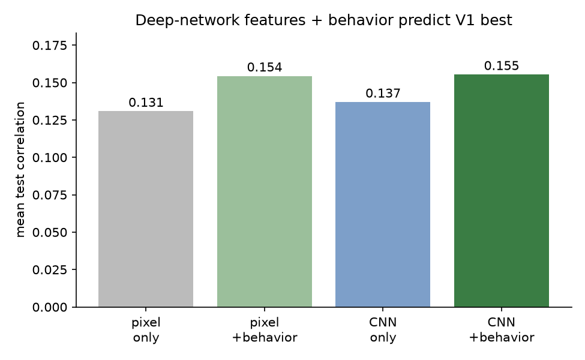

# Does Behavioral State Improve Prediction of Mouse Visual Cortex Activity?

*An encoding-model study of arousal and locomotion in mouse primary visual cortex (V1).*

**Author:** [Your Name] · **Collaborator:** Manish Mehta (parent)
**Code & data:** https://github.com/AmishI123/neuroscience-project

> This is a draft report intended as the application's "paper" attachment. Replace
> [Your Name], read it in full, and edit anything you'd say differently — it should
> sound like you.

---

## Abstract

Encoding models predict how visual-cortex neurons respond to images. Real neurons,
however, respond to the same image differently depending on the animal's internal
state. Using publicly available Sensorium 2022 recordings across three mice, we asked
whether adding pupil size and running speed improves prediction beyond the visual
stimulus alone. The original discovery mouse rose from **0.126 to 0.158**; two
pre-specified replications rose from **0.154 to 0.203** and **0.143 to 0.191**.
Pupil improved all three animals, while running contributed differently across them.
These results support the narrower predictive claim that behavioral state carries
information, while leaving population-level uncertainty and causality open.

## 1. Introduction

When a mouse views an image, neurons in its primary visual cortex (V1) fire. A central
goal of systems neuroscience is the **encoding model**: a function that predicts these
neural responses from the stimulus. But the brain is not a camera. The same image can
elicit different responses depending on whether the animal is alert or drowsy, moving
or still. Two commonly recorded signals summarize much of this internal state:
**pupil size** (larger pupils accompany heightened arousal) and **running speed**
(locomotion is known to boost V1 gain in mice).

We tested a simple, concrete question:

> **Does adding behavioral variables (pupil, running) to an encoding model improve its
> prediction of V1 activity, compared to using the visual stimulus alone?**

We deliberately used a transparent linear method (ridge regression) rather than a deep
network, so that every step is interpretable and the comparison between "stimulus only"
and "stimulus + behavior" is clean.

## 2. Data

We used one scan from the **Sensorium 2022** dataset (mouse `static21067-10-18`):

- **8,372 neurons** in V1 (all in layer 2/3), recorded with two-photon calcium imaging.
- **5,994 trials**, each a natural grayscale image (144×256 pixels) shown to the mouse.
- Simultaneous **behavior** per trial: pupil size, change in pupil size, running speed.
- Official split: 4,473 training / 523 validation / 998 test trials.

We trained on the training trials and evaluated on the combined validation + test
trials (1,521 held-out trials the model never saw).

## 3. Methods

**Stimulus features.** Each 144×256 image was downsampled to 36×64 by 4×4 block
averaging, standardized, and reduced to **150 principal components** (PCA fit on
training images only; these 150 components captured ~90% of image variance).

**Behavior features.** The three behavioral variables were standardized (using training
statistics only).

**Models.** We fit ridge-regression models (scikit-learn, regularization α = 1000) that
predict all 8,372 neurons simultaneously:

- **Model A (baseline):** stimulus features only.
- **Model B (extended):** stimulus features + behavior.
- **Ablations:** stimulus + running only; stimulus + pupil only.

**Evaluation.** For each neuron we computed the Pearson correlation between predicted
and actual responses across held-out trials, then averaged across neurons. All
preprocessing was fit on training data only, to avoid leakage.

## 4. Results

### 4.1 Behavior improves prediction — and it's pupil, not running

Mean test correlation rose from **0.126** (stimulus only) to **0.158** (stimulus +
behavior), a **~25% relative improvement**. The ablation is decisive: adding running
alone barely changed anything (0.127), while adding pupil alone captured essentially the
entire gain (0.158). This makes sense given the behavior itself: **the mouse was running
on only 5.4% of trials**, so locomotion carried almost no usable signal, whereas pupil
(arousal) varied continuously.

### 4.2 Most neurons improve; a tail improves a lot

About **90% of neurons** were predicted better with behavior. The distribution is
right-skewed (mean +0.032, median +0.017): most neurons gain modestly, but a tail gains
substantially (up to +0.36).

### 4.3 The winners are the arousal-sensitive neurons

We measured each neuron's **arousal modulation** as the correlation between its response
and pupil size (as in our exploratory analysis). Improvement from behavior rises clearly
with arousal modulation: neurons whose activity tracked arousal (pupil correlation > 0.1;
n = 2,750) improved by **+0.069 on average**, versus **+0.014** for the rest. The model
gains most exactly where behavior carries information — a satisfying internal consistency.

### 4.4 The effect is spread across the cortex

Coloring each neuron by its improvement at its physical location reveals **no strong
spatial clustering** (correlation between improvement and cortical depth ≈ 0). Arousal
modulation appears to be a distributed property of the L2/3 population, not confined to
a patch.

### 4.5 A dramatic single example

Neuron 3035 was nearly unpredictable from the stimulus alone (correlation 0.05). Adding
behavior raised its prediction to **0.40** — turning noise into a clear relationship.
This neuron is essentially arousal-driven: knowing the image barely helps, but knowing
the mouse's state does.

### 4.6 Extension: do deep-network features help? (deep-learning stretch)

We asked whether features from a **pretrained deep network** predict V1 better than the
simple pixel summary. Using a pretrained ResNet-50 as a fixed feature extractor (a
middle layer, at the image's native resolution to preserve spatial layout), we compared
four models, selecting regularization on validation and reporting on the test set:

| Stimulus model | without behavior | with behavior |
|---|---|---|
| pixel summary | 0.131 | 0.154 |
| **deep-network (CNN) features** | **0.137** | **0.155** |

Two honest observations:

1. **CNN features modestly beat raw pixels** (0.137 vs 0.131). Middle-layer features of a
   network trained on natural images are slightly more "V1-like" than raw pixels — but
   only slightly, which is expected: the network was trained to recognize ImageNet
   objects, not to match a mouse brain.
2. **Behavior helps regardless of the stimulus model** (CNN: 0.137 → 0.155; ~63% of
   neurons improved, arousal-sensitive neurons +0.052). The behavior effect is *robust*
   to the modeling choice — a reassuring check that our main conclusion is not an
   artifact of using a simple stimulus model.

Notably, switching from pixels to CNN features (+0.006) helped *less* than adding
behavior (+0.02–0.03). In other words, for this data, **knowing the animal's internal
state was at least as valuable as using a more sophisticated image model.**

### 4.7 Cross-animal replication

To test whether the headline result was specific to the original mouse, we ran the
same four-model pipeline on two additional Sensorium recordings. The runner uses the
same 4×4 image downsampling, 150-component PCA, training-only standardization, ridge
alpha 1000, and official chronological train/validation/test tiers.

| Mouse | Stimulus only | + running | + pupil | + both | Relative gain |
|---|---:|---:|---:|---:|---:|
| `static21067-10-18` | 0.1265 | 0.1271 | 0.1578 | **0.1583** | +25.1% |
| `static22846-10-16` | 0.1543 | 0.1696 | 0.1936 | **0.2034** | +31.8% |
| `static23343-5-17` | 0.1431 | 0.1603 | 0.1799 | **0.1905** | +33.1% |

The qualitative conclusion replicated: adding behavior improved held-out prediction
in all three mice. The useful signal was not identical, however. Running barely changed
the first mouse, improved the second from 0.1543 to 0.1696, and improved the third
from 0.1431 to 0.1603; pupil improved all three.
This strengthens the narrower claim that behavioral state carries predictive
information while reinforcing that the relative contribution of running and pupil is
animal-dependent. The complete per-mouse metrics are in
`results/per_mouse_metrics.csv`, and the executable pipeline is
`src/replicate_mouse.py`. A 200-resample bootstrap over neurons within each animal
gave descriptive 95% intervals for stimulus-only versus stimulus-plus-behavior of
0.1250–0.1283 versus 0.1565–0.1600 in the first mouse, 0.1525–0.1562 versus
0.2013–0.2054 in the second, and 0.1411–0.1447 versus 0.1889–0.1926 in the third.
These intervals quantify within-animal measurement variation; they are not
hierarchical confidence intervals across animals.

For a separate animal-level descriptive summary, `src/summarize_replication.py`
reports a mean absolute gain of **0.0428** correlation points across the three
animals (sample SD **0.0095**, range **0.0318–0.0491**) and a mean relative gain
of **30.0%** (sample SD **4.3 percentage points**). This summary treats each
recording as one animal and does not pool its neurons into a population estimate.

As a descriptive stability check, we also recomputed the mean absolute gain after
omitting each animal in turn. The leave-one-animal-out means are **0.0482** when
omitting the original mouse, **0.0396** when omitting the second mouse, and
**0.0404** when omitting the third mouse. All remain positive, but this is a
three-animal sensitivity analysis—not a population estimate or hierarchical
confidence interval.

### Behavior-shuffle negative control

As a control for trial alignment, we independently permuted the three behavior
columns across trials within each animal and refit the stimulus-plus-behavior model
20 times per animal. The aligned gains were **+0.0318**, **+0.0491**, and **+0.0474**
correlation points. The shuffled-behavior mean gains were **−0.00046**, **−0.00048**,
and **−0.00049**, respectively. This control is consistent with the observed gain
depending on aligned behavior rather than an arbitrary extra feature block. It is
not a causal test, a population null distribution, or proof that behavior causes
the neural responses. Full seeds and ranges are in
`results/shuffled_behavior_controls.json`.

## 5. Discussion

Our central finding — that behavioral state improves encoding models of V1 — reproduces
a well-established principle in mouse visual neuroscience using simple, interpretable
tools. The more interesting nuance is that **the identity of the useful behavioral
signal depended on the animal**. Textbooks emphasize locomotion's effect on V1, but in
this mostly-stationary mouse, arousal (pupil) carried the signal and running did not.
This is a useful reminder that behavioral variables are only informative to the extent
the behavior actually varies.

The result also has a clean interpretation: part of a neuron's trial-to-trial
variability that looks like "noise" to a stimulus-only model is in fact **structured by
internal state**, and can be recovered by measuring that state.

## 6. Limitations

- **Linear model.** Ridge regression on PCA image features is a weak stimulus model;
  V1 responses are nonlinear, so our baseline correlation (~0.13) is modest. State-of-
  the-art deep networks predict V1 far better. Our claim is comparative (behavior helps
  *relative to the same stimulus model*), which the design supports, but absolute
  accuracy is low.
- **Small animal sample.** Three animals provide replication evidence, but not a
  population estimate or hierarchical confidence interval.
- **Correlational.** We show behavior improves *prediction*; we do not establish a
  causal or mechanistic account of how arousal modulates responses.

## 7. Future work

- Repeat beyond three animals and pre-specify a hierarchical population summary.
- Improve the deep-network readout (Section 4.6): a spatially-resolved readout or a CNN
  *fine-tuned* on neural data (rather than frozen ImageNet features) should widen the gap
  over pixels and is the standard route to state-of-the-art V1 prediction.
- Compare which neurons a CNN vs. a linear model predicts well (a bridge to the
  "which architecture looks most like the brain?" question).

## 8. Reproducibility

All code is in the repository as six documented notebooks
(`notebooks/01`–`06`), runnable in Google Colab (notebook 06 needs a GPU runtime). The dataset is downloaded
automatically from the public Sensorium repository. Every figure in this report was
generated from the code in this project.

## References

1. Willeke et al. (2022). *The Sensorium competition on predicting large-scale mouse
   primary visual cortex activity.* arXiv:2206.08666. Dataset:
   https://gin.g-node.org/cajal/Sensorium2022
2. Niell & Stryker (2010). *Modulation of visual responses by behavioral state in mouse
   visual cortex.* Neuron. (Locomotion boosts V1 activity.)
3. Reimer et al. (2014). *Pupil fluctuations track fast switching of cortical states
   during quiet wakefulness.* Neuron. (Pupil as an arousal proxy.)
