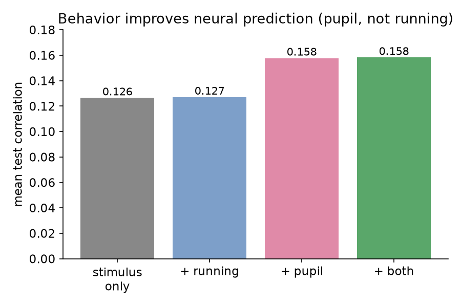
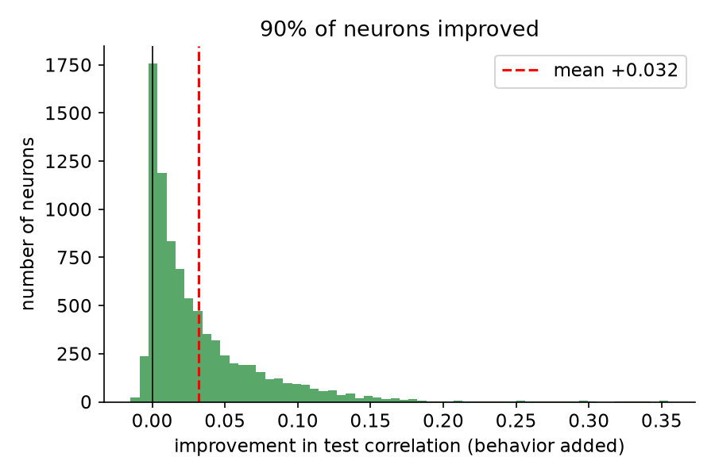
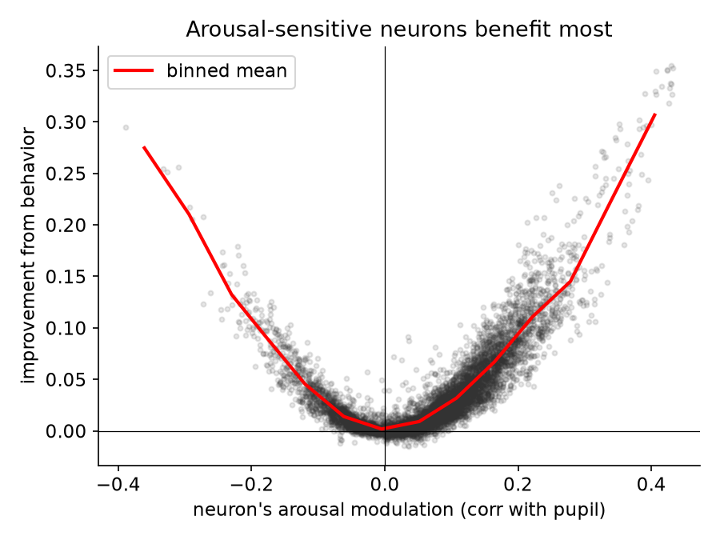
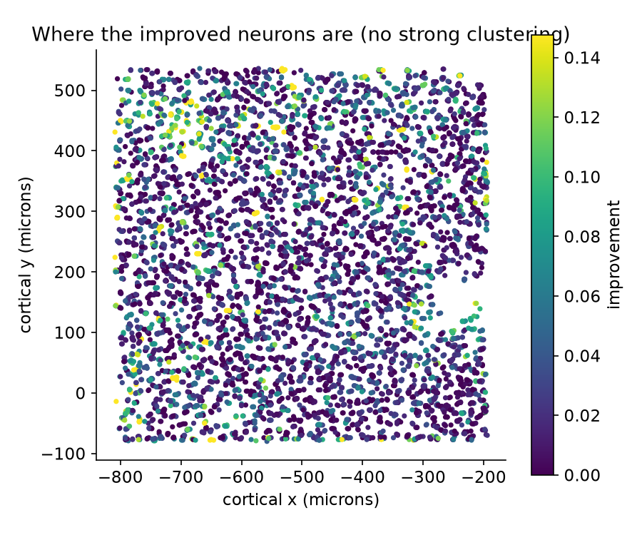
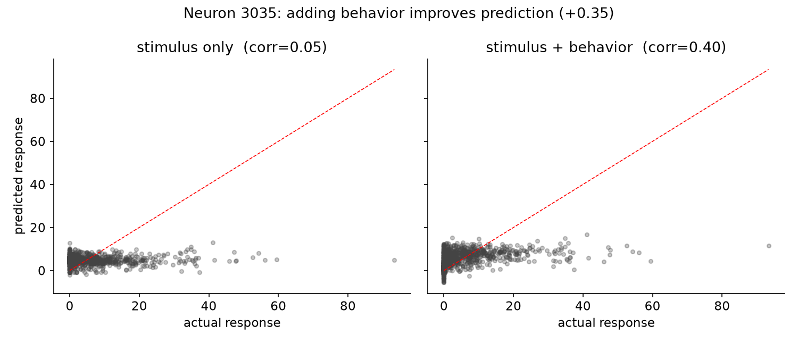

# Does Behavioral State Improve Prediction of Mouse Visual Cortex Activity?

*An encoding-model study of arousal and locomotion in mouse primary visual cortex (V1).*

**Author:** [Your Name] · **Collaborator:** Manish Mehta (parent)
**Code & data:** https://github.com/AmishI123/neuroscience-project

> This is a draft report intended as the application's "paper" attachment. Replace
> [Your Name], read it in full, and edit anything you'd say differently — it should
> sound like you.

---

## Abstract

Encoding models predict how visual-cortex neurons respond to images. Real neurons,
however, respond to the same image differently depending on the animal's internal
state. Using publicly available recordings of 8,372 neurons in mouse primary visual
cortex (Sensorium 2022), we asked whether adding two behavioral variables — pupil size
(a proxy for arousal) and running speed (locomotion) — improves prediction beyond the
visual stimulus alone. Using ridge-regression encoding models evaluated on held-out
trials, adding behavior raised mean predicted-vs-actual correlation from **0.126 to
0.158 (a ~25% relative improvement)**, and improved **~90% of neurons**. An ablation
showed the entire gain came from **pupil/arousal, not running** — because this mouse
ran on only 5.4% of trials. The neurons that benefited most were precisely those whose
activity tracked arousal. The effect was distributed across the cortical surface rather
than clustered. These results reproduce, with fully transparent methods, the known
principle that internal state shapes cortical responses, and show that *which*
behavioral signal matters is an empirical, per-animal question.

## 1. Introduction

When a mouse views an image, neurons in its primary visual cortex (V1) fire. A central
goal of systems neuroscience is the **encoding model**: a function that predicts these
neural responses from the stimulus. But the brain is not a camera. The same image can
elicit different responses depending on whether the animal is alert or drowsy, moving
or still. Two commonly recorded signals summarize much of this internal state:
**pupil size** (larger pupils accompany heightened arousal) and **running speed**
(locomotion is known to boost V1 gain in mice).

We tested a simple, concrete question:

> **Does adding behavioral variables (pupil, running) to an encoding model improve its
> prediction of V1 activity, compared to using the visual stimulus alone?**

We deliberately used a transparent linear method (ridge regression) rather than a deep
network, so that every step is interpretable and the comparison between "stimulus only"
and "stimulus + behavior" is clean.

## 2. Data

We used one scan from the **Sensorium 2022** dataset (mouse `static21067-10-18`):

- **8,372 neurons** in V1 (all in layer 2/3), recorded with two-photon calcium imaging.
- **5,994 trials**, each a natural grayscale image (144×256 pixels) shown to the mouse.
- Simultaneous **behavior** per trial: pupil size, change in pupil size, running speed.
- Official split: 4,473 training / 523 validation / 998 test trials.

We trained on the training trials and evaluated on the combined validation + test
trials (1,521 held-out trials the model never saw).

## 3. Methods

**Stimulus features.** Each 144×256 image was downsampled to 36×64 by 4×4 block
averaging, standardized, and reduced to **150 principal components** (PCA fit on
training images only; these 150 components captured ~90% of image variance).

**Behavior features.** The three behavioral variables were standardized (using training
statistics only).

**Models.** We fit ridge-regression models (scikit-learn, regularization α = 1000) that
predict all 8,372 neurons simultaneously:

- **Model A (baseline):** stimulus features only.
- **Model B (extended):** stimulus features + behavior.
- **Ablations:** stimulus + running only; stimulus + pupil only.

**Evaluation.** For each neuron we computed the Pearson correlation between predicted
and actual responses across held-out trials, then averaged across neurons. All
preprocessing was fit on training data only, to avoid leakage.

## 4. Results

### 4.1 Behavior improves prediction — and it's pupil, not running

Mean test correlation rose from **0.126** (stimulus only) to **0.158** (stimulus +
behavior), a **~25% relative improvement**. The ablation is decisive: adding running
alone barely changed anything (0.127), while adding pupil alone captured essentially the
entire gain (0.158). This makes sense given the behavior itself: **the mouse was running
on only 5.4% of trials**, so locomotion carried almost no usable signal, whereas pupil
(arousal) varied continuously.

### 4.2 Most neurons improve; a tail improves a lot

About **90% of neurons** were predicted better with behavior. The distribution is
right-skewed (mean +0.032, median +0.017): most neurons gain modestly, but a tail gains
substantially (up to +0.36).

### 4.3 The winners are the arousal-sensitive neurons

We measured each neuron's **arousal modulation** as the correlation between its response
and pupil size (as in our exploratory analysis). Improvement from behavior rises clearly
with arousal modulation: neurons whose activity tracked arousal (pupil correlation > 0.1;
n = 2,750) improved by **+0.069 on average**, versus **+0.014** for the rest. The model
gains most exactly where behavior carries information — a satisfying internal consistency.

### 4.4 The effect is spread across the cortex

Coloring each neuron by its improvement at its physical location reveals **no strong
spatial clustering** (correlation between improvement and cortical depth ≈ 0). Arousal
modulation appears to be a distributed property of the L2/3 population, not confined to
a patch.

### 4.5 A dramatic single example

Neuron 3035 was nearly unpredictable from the stimulus alone (correlation 0.05). Adding
behavior raised its prediction to **0.40** — turning noise into a clear relationship.
This neuron is essentially arousal-driven: knowing the image barely helps, but knowing
the mouse's state does.

## 5. Discussion

Our central finding — that behavioral state improves encoding models of V1 — reproduces
a well-established principle in mouse visual neuroscience using simple, interpretable
tools. The more interesting nuance is that **the identity of the useful behavioral
signal depended on the animal**. Textbooks emphasize locomotion's effect on V1, but in
this mostly-stationary mouse, arousal (pupil) carried the signal and running did not.
This is a useful reminder that behavioral variables are only informative to the extent
the behavior actually varies.

The result also has a clean interpretation: part of a neuron's trial-to-trial
variability that looks like "noise" to a stimulus-only model is in fact **structured by
internal state**, and can be recovered by measuring that state.

## 6. Limitations

- **Linear model.** Ridge regression on PCA image features is a weak stimulus model;
  V1 responses are nonlinear, so our baseline correlation (~0.13) is modest. State-of-
  the-art deep networks predict V1 far better. Our claim is comparative (behavior helps
  *relative to the same stimulus model*), which the design supports, but absolute
  accuracy is low.
- **One animal.** Findings about running vs. pupil are specific to this mouse's behavior.
- **Correlational.** We show behavior improves *prediction*; we do not establish a
  causal or mechanistic account of how arousal modulates responses.

## 7. Future work

- Repeat on a mouse that ran more, to give running a fair test.
- Replace the linear stimulus model with a pretrained convolutional network's features,
  which should raise the baseline and may change how much behavior adds on top.
- Compare which neurons a CNN vs. a linear model predicts well (a bridge to the
  "which architecture looks most like the brain?" question).

## 8. Reproducibility

All code is in the repository as five documented notebooks
(`notebooks/01`–`05`), runnable in Google Colab. The dataset is downloaded
automatically from the public Sensorium repository. Every figure in this report was
generated from the code in this project.

## References

1. Willeke et al. (2022). *The Sensorium competition on predicting large-scale mouse
   primary visual cortex activity.* arXiv:2206.08666. Dataset:
   https://gin.g-node.org/cajal/Sensorium2022
2. Niell & Stryker (2010). *Modulation of visual responses by behavioral state in mouse
   visual cortex.* Neuron. (Locomotion boosts V1 activity.)
3. Reimer et al. (2014). *Pupil fluctuations track fast switching of cortical states
   during quiet wakefulness.* Neuron. (Pupil as an arousal proxy.)
